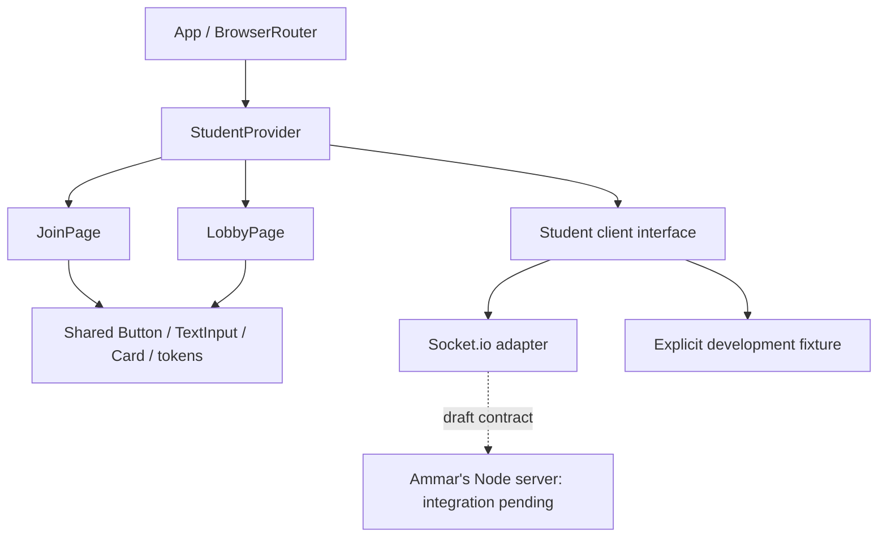

# Nathaniel Fadrigon: implementation plan and branch review

Historical Sprint 1 review. Current architecture, implemented features and test
evidence are in [implementation status](implementation-status.md),
[game contract](game-contract.md), and [sprint report](sprint-report.md).

Reviewed October 31, 2026. Repository: <https://github.com/nbound/Grasp>.

## Framework added

Branch: `feat/nathaniel-student-frontend`, created from `origin/main` at
`6a86fc0fbbc353bbe1959f5c85547c8e9f12af57` (the current remote `main`). The
feature branch contains the implementation and review notes and is being pushed
to GitHub with explicit user approval. `main` has not been changed; nothing has
been deployed or merged.

The branch reuses `dev`'s dependency versions, lockfile baseline, Vite/Tailwind
configuration, lint/format tools, and React entry point. It adds `socket.io-client`
and a test script, student routes `/join` and `/lobby`, shared accessible controls,
validated public models, and a provider with socket subscription/request cleanup.
The demo client is explicit, development-only, and single-browser. Live mode
uses `VITE_GAME_SERVER_URL`. All team assignment and lobby state remain server
responsibilities. Guest access does not require Supabase authentication.

## Connecting the branches

1. **Frontend baseline (`dev`, Howard):** integrate this branch's student modules
   with the scaffold. Existing configuration files were reused to limit conflicts.
   Keep one router at the application root; retain the student routes when Amrit
   adds teacher routes. The current wildcard redirects to `/join` and must be
   narrowed when teacher routes are composed.
2. **Real-time server (Ammar, GR-05–08):** agree the draft
   [socket contract](student-socket-contract.md), set `VITE_GAME_SERVER_URL`, and
   allow the deployed frontend's origin in server CORS. If his payloads differ,
   translate them in `socketStudentClient.js`; the pages should continue consuming
   the same public membership model. Retest host plus at least three browser tabs.
3. **Teacher UI (Amrit, GR-13–15/24–25):** reuse the shared UI tokens/controls and
   route shell. Host and student lobbies should consume the same server snapshots;
   host controls advance the server state, not local student state.
4. **Database/auth (`schema`, Howard, GR-09–11/26):** obtain actual versioned SQL
   migrations and RLS rules. Remove or narrow `*.sql` in `schema`'s ignore rules
   so migrations can be tracked. Keep Supabase secrets on the server. Teacher
   auth and quiz editing can use the browser publishable key with RLS; guest
   sockets remain independent. Define results/identity boundaries before CSV and
   optional student history work.
5. **Gameplay integration:** extend the student service/provider after server
   question/answer/reveal contracts are agreed. Server game state, scoring, team
   totals, streaks and persistence stay authoritative. No speed bonus, default
   timer, or client scoring is introduced by this framework.

Because both branches independently add frontend files to a README-only main,
some shared-file add/add conflicts are expected. Resolve the student app shell,
base styles and page title in favor of this implementation; retain teacher
changes when they exist. Combine package scripts/dependencies and regenerate
`package-lock.json` with npm rather than hand-editing lockfile conflicts.
The new student feature/UI directories do not exist in the reviewed branches.
The frontend README and environment example require combining the relevant documentation
and values. The eventual `schema` integration also requires deciding how to
track SQL instead of inheriting its blanket exclusion.

A Git merge-tree dry run against `dev` identifies add/add conflicts in
`frontend/.env.example`, `frontend/.prettierrc`, `frontend/README.md`,
`frontend/index.html`, `frontend/package.json`, `frontend/package-lock.json`,
`frontend/src/App.jsx`, `frontend/src/index.css`, and `frontend/vite.config.js`.
The prettier and Vite config differences are only final newlines. The root
ignore rules and other unchanged scaffold files match `dev`. No merge was
applied to this branch; this is a reviewable integration path, not a claim that
the branches merge automatically.

## Current component diagram (GR-17 working source)



## Current guest join sequence

```mermaid
sequenceDiagram
  actor Student
  participant Form as JoinPage
  participant State as StudentProvider
  participant Adapter as SocketStudentClient
  participant Server as Node server (pending)
  Student->>Form: PIN and nickname
  Form->>Form: Validate and focus invalid fields
  Form->>State: join(normalized values)
  State->>Adapter: join(values)
  Adapter->>Server: player_join + acknowledgement callback
  alt rejected or timed out
    Server-->>Adapter: error / no acknowledgement
    Adapter-->>State: reject
    State-->>Form: Display error; remain on join page
  else accepted
    Server-->>Adapter: playerId + public lobby snapshot
    Adapter-->>State: validated membership
    State-->>Form: join succeeded
    Form->>Form: Navigate to /lobby
    Server-->>Adapter: lobby_update snapshots
    Adapter-->>State: update matching membership
  end
```

## Verification and remaining limits

Validation passed: **14 unit tests**, ESLint, Prettier format check, the Vite
production build, and **8 Chromium workflow checks** with no browser errors.
Validation uses Node 24 and the existing Vite/lint/format configuration. Tests
cover join normalization/errors, public snapshot validation, unrelated session
updates, malformed/rejected/timed-out acknowledgements, offline emit prevention,
and listener cleanup. Chromium checks exercise the demo plus a local Socket.io
test server, including nickname rejection, live count updates, leaving,
disconnection, route guarding and a 320px mobile layout.

These checks do not replace integration against Ammar's production server,
Howard's database/auth/RLS, or Amrit's teacher flow. The original end-to-end smoke
test remains: teacher creates quiz, hosts it, and three independent tabs join
the same lobby. Reconnect identity, gameplay, feedback audio, progress, CSV,
optional accounts and final DOCX/PDF updates remain future tasks.
