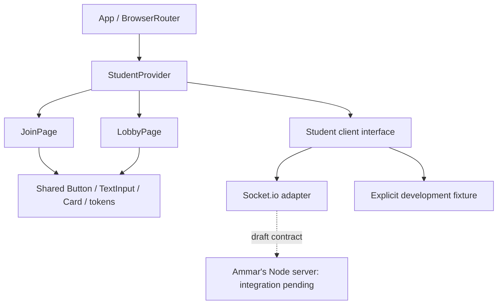

# Nathaniel Fadrigon: implementation plan and branch review

Reviewed October 31, 2026. Repository: <https://github.com/nbound/Grasp>.

## Scope and source reconciliation

The uploaded product backlog assigns Nathaniel the student frontend; the Sprint
1 report swaps his assignments with Ammar and describes Nathaniel as the server
owner. The user explicitly selected **the backlog's student frontend ownership**.
The report and feature summary supply product context, not instructions to edit
external trackers, contact teammates, publish, deploy, or export the course report.
The uploaded originals and their status columns have not been changed.

The product is a team-based review tool with guest PIN access, teacher-paced
questions, explanatory feedback, and detailed results. P0 scoring never rewards
speed; streaks are visual. Timers, AI question drafts, configurable feedback,
and optional student accounts follow as P1 work. The report qualifies the earlier
feature summary: survey respondents rated studying and testing equally, while
learning new content rated lowest. This does not change the P0 implementation.

The report dates Sprint 1 to Sep 26–Oct 9 and says much implementation carries
over. The backlog warns that sprint dates are assumed. This plan preserves the
backlog's sprint numbers and estimates rather than inventing new calendar dates.
Nathaniel's assigned estimates total **34.5 hours**; they are original planning
estimates, not revised remaining-time estimates.

## Sprint sequence and acceptance checks

| Sprint | Task | Backlog estimate | Implementation and acceptance |
| --- | --- | ---: | --- |
| 1 | GR-04 Shared UI kit | 3 h | Start with scoped color/type tokens, Button, TextInput, Card. Reuse on teacher pages; check keyboard focus, labeled errors and narrow screens. Initial kit added in this branch. |
| 1 | GR-02 Student join | 4 h | Validate a six-digit string PIN and nickname; pending/error states; join only after server acknowledgement. Check bad PIN, duplicate name, timeout, disconnect and repeated submission. Framework added; validate against Ammar's real server before marking Done. |
| 1 | GR-03 Student lobby | 3 h | Render confirmed nickname/team, full roster and count from server snapshots; handle leave and membership loss. Test multiple real tabs after the server lands. Framework added and exercised against a test Socket.io server. |
| 1 | GR-17 UML updates | 1.5 h | Component and guest-join sequence diagrams below describe current code. Transfer reconciled diagrams into the course report after integration; the uploaded DOCX is unchanged. |
| 2 | GR-19 Question screen | 4 h | Add a public question model and four answer controls. Track question identity, pending submission and accepted answer; lock duplicate submissions. Handle late acknowledgements and teacher advancement using server state. Depends on Ammar's GR-21 and Amrit's GR-24. |
| 2 | GR-20 Instant feedback | 4 h | Show full-screen correct/incorrect feedback with text/icon, correct answer and explanation. Add user-enabled/mutable audio after browser interaction; respect reduced motion. Do not convey correctness only by color. Depends on private server feedback and persisted answers. |
| 2 | GR-29 Documentation | 2 h | Add gameplay sequence/state diagrams once the contract exists, record verified Sprint 2 results and carryover. Keep placeholder behavior separate from completed integration. |
| 3 | GR-30 Progress/streak | 3 h | Render server-derived progress and a visual streak badge; never modify score. Handle zero questions and reconnect snapshots. Coordinate with GR-23/34. |
| 3 | GR-31 Personal results/CSV | 4 h | Show only this player's results and export question, submitted/correct answer, explanation, correctness/score, attempts and time. Use Papa Parse when implemented; check quoting, line breaks, Unicode and spreadsheet formula handling. Depends on Howard's GR-26 and authorized results access. |
| 4 | GR-41 Optional login/history | 6 h | Add optional Supabase login and user-scoped study history after guest gameplay works. Preserve account-free join. Agree guest-to-account linking and history RLS with Howard before implementation. |

Sprint 1 totals 11.5 h; Sprint 2 totals 10 h; Sprint 3 totals 7 h; Sprint 4
totals 6 h. Later-sprint screens and data persistence have **not** been implemented.

## Framework added

Branch: `feat/nathaniel-student-frontend`, created from `origin/main` at
`6a86fc0fbbc353bbe1959f5c85547c8e9f12af57` (the current remote `main`). The
feature branch contains the implementation and review notes and is being pushed
to GitHub with explicit user approval. `main` has not been changed; nothing has
been deployed or merged.

The branch reuses `dev`'s dependency versions, lockfile baseline, Vite/Tailwind
configuration, lint/format tools, and React entry point. It adds `socket.io-client`
and a test script, student routes `/join` and `/lobby`, shared accessible controls,
validated public models, and a provider with socket subscription/request cleanup.
The demo client is explicit, development-only, and single-browser. Live mode
uses `VITE_GAME_SERVER_URL`. All team assignment and lobby state remain server
responsibilities. Guest access does not require Supabase authentication.

## Other branches: observed committed code

| Branch | Head | Changes relative to main | What this means |
| --- | --- | --- | --- |
| `main` | `6a86fc0` | Initial commit: project README only | No application or server to extend directly. |
| `dev` | `017afc7` | 3 commits ahead, 0 behind. React/Vite starter; Tailwind Vite plugin; React Router and Supabase dependencies; ESLint/Prettier; frontend/server environment examples; ignore rules. Howard Wei authored the commits, including merge PR #1 from `react-setup`. | `App.jsx` is still the Vite demo/counter. Router is installed but no routes are mounted. No teacher/auth/quiz/student features, socket client, or server implementation are committed. |
| `schema` | `37c5182` | 4 commits ahead of main; includes dev plus one commit titled `add schema`. That commit changes only `.gitignore`, appending `*.sql`. | No schema, migration, RLS policy, Supabase client initialization or answer persistence is committed. The branch name/commit title do not establish that the database is implemented. |

The remote lists exactly these three branches at review time. `react-setup`
appears in merged history but is not a current remote branch. Useful comparisons:
[main → dev](https://github.com/nbound/Grasp/compare/main...dev) and
[dev → schema](https://github.com/nbound/Grasp/compare/dev...schema).
This is a review of committed repository code; it cannot establish the state of
any uncommitted work or the external Supabase project.

## Connecting the branches

1. **Frontend baseline (`dev`, Howard):** integrate this branch's student modules
   with the scaffold. Existing configuration files were reused to limit conflicts.
   Keep one router at the application root; retain the student routes when Amrit
   adds teacher routes. The current wildcard redirects to `/join` and must be
   narrowed when teacher routes are composed.
2. **Real-time server (Ammar, GR-05–08):** agree the draft
   [socket contract](student-socket-contract.md), set `VITE_GAME_SERVER_URL`, and
   allow the deployed frontend's origin in server CORS. If his payloads differ,
   translate them in `socketStudentClient.js`; the pages should continue consuming
   the same public membership model. Retest host plus at least three browser tabs.
3. **Teacher UI (Amrit, GR-13–15/24–25):** reuse the shared UI tokens/controls and
   route shell. Host and student lobbies should consume the same server snapshots;
   host controls advance the server state, not local student state.
4. **Database/auth (`schema`, Howard, GR-09–11/26):** obtain actual versioned SQL
   migrations and RLS rules. Remove or narrow `*.sql` in `schema`'s ignore rules
   so migrations can be tracked. Keep Supabase secrets on the server. Teacher
   auth and quiz editing can use the browser publishable key with RLS; guest
   sockets remain independent. Define results/identity boundaries before CSV and
   optional student history work.
5. **Gameplay integration:** extend the student service/provider after server
   question/answer/reveal contracts are agreed. Server game state, scoring, team
   totals, streaks and persistence stay authoritative. No speed bonus, default
   timer, or client scoring is introduced by this framework.

Because both branches independently add frontend files to a README-only main,
some shared-file add/add conflicts are expected. Resolve the student app shell,
base styles and page title in favor of this implementation; retain teacher
changes when they exist. Combine package scripts/dependencies and regenerate
`package-lock.json` with npm rather than hand-editing lockfile conflicts.
The new student feature/UI directories do not exist in the reviewed branches.
The frontend README and environment example require combining the relevant documentation
and values. The eventual `schema` integration also requires deciding how to
track SQL instead of inheriting its blanket exclusion.

A Git merge-tree dry run against `dev` identifies add/add conflicts in
`frontend/.env.example`, `frontend/.prettierrc`, `frontend/README.md`,
`frontend/index.html`, `frontend/package.json`, `frontend/package-lock.json`,
`frontend/src/App.jsx`, `frontend/src/index.css`, and `frontend/vite.config.js`.
The prettier and Vite config differences are only final newlines. The root
ignore rules and other unchanged scaffold files match `dev`. No merge was
applied to this branch; this is a reviewable integration path, not a claim that
the branches merge automatically.

## Current component diagram (GR-17 working source)



## Current guest join sequence

```mermaid
sequenceDiagram
  actor Student
  participant Form as JoinPage
  participant State as StudentProvider
  participant Adapter as SocketStudentClient
  participant Server as Node server (pending)
  Student->>Form: PIN and nickname
  Form->>Form: Validate and focus invalid fields
  Form->>State: join(normalized values)
  State->>Adapter: join(values)
  Adapter->>Server: player_join + acknowledgement callback
  alt rejected or timed out
    Server-->>Adapter: error / no acknowledgement
    Adapter-->>State: reject
    State-->>Form: Display error; remain on join page
  else accepted
    Server-->>Adapter: playerId + public lobby snapshot
    Adapter-->>State: validated membership
    State-->>Form: join succeeded
    Form->>Form: Navigate to /lobby
    Server-->>Adapter: lobby_update snapshots
    Adapter-->>State: update matching membership
  end
```

## Verification and remaining limits

Validation passed: **14 unit tests**, ESLint, Prettier format check, the Vite
production build, and **8 Chromium workflow checks** with no browser errors.
Validation uses Node 24 and the existing Vite/lint/format configuration. Tests
cover join normalization/errors, public snapshot validation, unrelated session
updates, malformed/rejected/timed-out acknowledgements, offline emit prevention,
and listener cleanup. Chromium checks exercise the demo plus a local Socket.io
test server, including nickname rejection, live count updates, leaving,
disconnection, route guarding and a 320px mobile layout.

These checks do not replace integration against Ammar's production server,
Howard's database/auth/RLS, or Amrit's teacher flow. The original end-to-end smoke
test remains: teacher creates quiz, hosts it, and three independent tabs join
the same lobby. Reconnect identity, gameplay, feedback audio, progress, CSV,
optional accounts and final DOCX/PDF updates remain future tasks.
