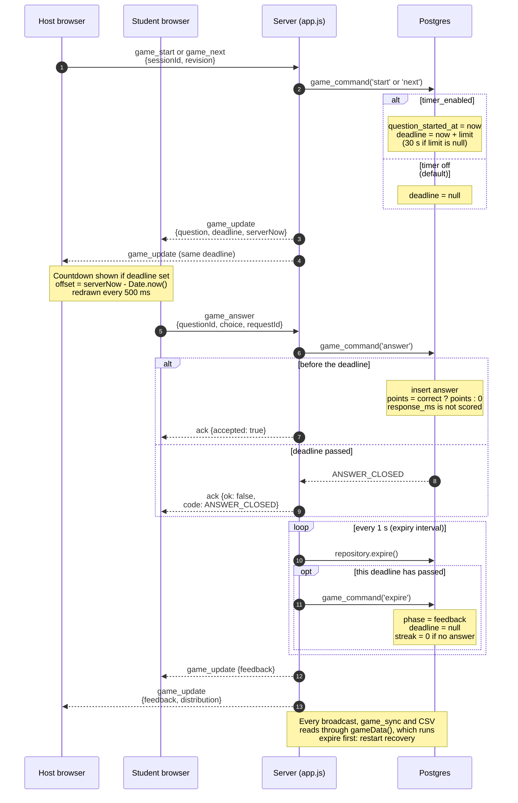
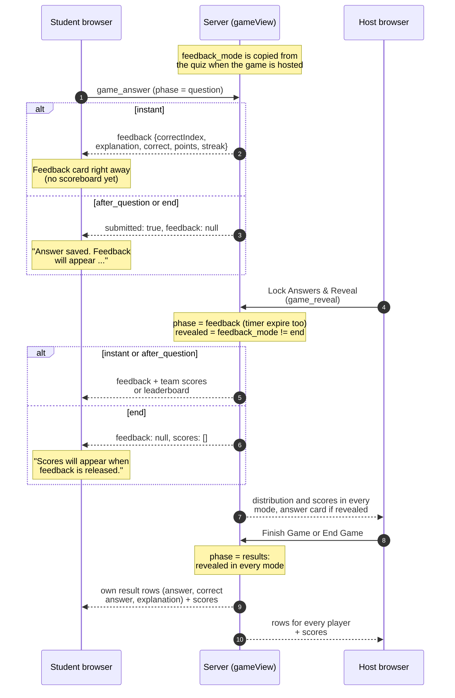
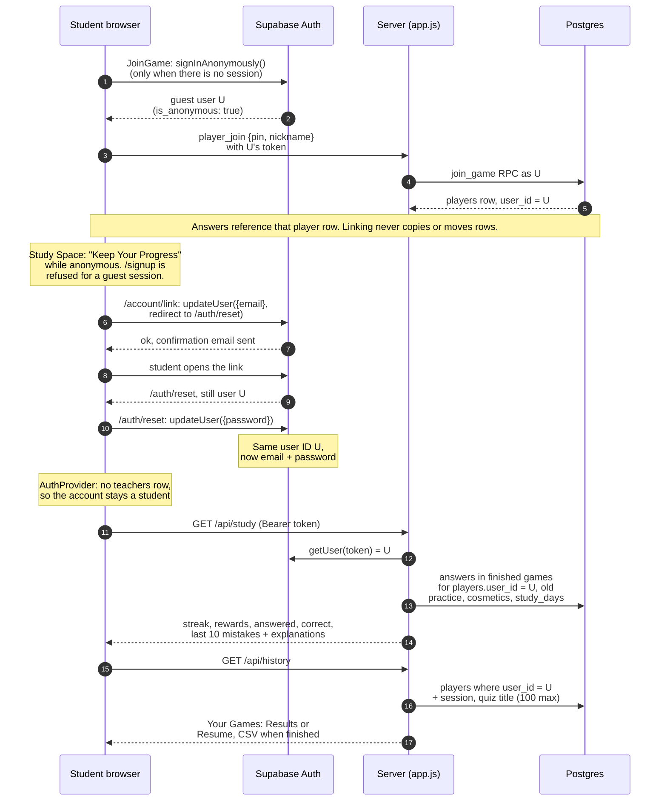
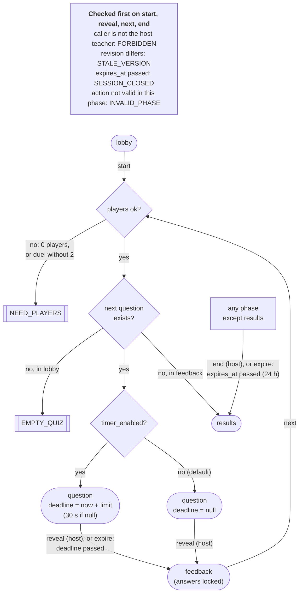
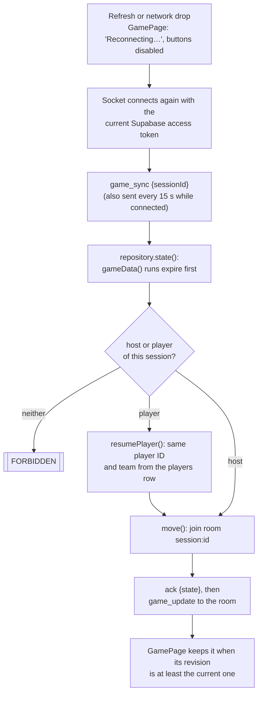

# Sprint 4 diagrams

Sprint 4 covers GR-38 (per-quiz timer, off by default, never affects score), GR-39
(AI drafting, removed), GR-40 (feedback modes), GR-41 (student account linking and
history) and GR-42 (docs and demo). Each diagram below is drawn from the code, and
each note names the file and function or RPC it follows. Diagram 5 is the reconnect
half of the state machine in diagram 4, kept separate so both stay legible.

## 1. Timed question flow (GR-38)

`public.game_command` in `supabase/migrations/20261106000000_game_creation.sql` sets
`question_started_at` on every `start` and `next`, and sets `deadline` only when the
session's `timer_enabled` is true, using `time_limit_seconds` (5 to 600, enforced by
the `questions` check constraint and `validateQuiz`) or 30 seconds when it is null.
The `answer` branch awards the question's fixed points and stores `response_ms` for
reports only, and `Countdown` in `frontend/src/features/game/GamePage.jsx` renders for
host and students whenever `deadline` is set. The 1-second `expiry` interval in
`createApp` (`server/src/app.js`) and `gameData()` in
`server/src/game/repository.js` both call `game_command(..., 'expire')`, so an overdue
question closes even after a server restart; the host can still close it early with
Lock Answers & Reveal.

## 2. Feedback-mode release (GR-40)

`gameView` in `server/src/game/state.js` builds each socket's state: `revealed` is
true in `results`, or in `feedback` unless the mode is `end`; a student also gets
`feedback` in `instant` mode once they have an answer; scores go to the host always
and to students only when revealed. `GamePage.jsx` renders the feedback card, the
"Scores will appear when feedback is released." placeholder and the results table
from those fields, and the payloads arrive through both `game_update` and the
`game_sync` reply. Because the host view always includes scores, a projected host
screen shows team totals after each lock even in end-of-game mode.

## 3. Student account linking and study history (GR-41)

`JoinGame.jsx` creates the guest with `signInAnonymously()`, then `AuthPage` mode
`link` (`frontend/src/features/auth/AuthPage.jsx`) calls `updateUser({ email })` with
a redirect to `/auth/reset`, where mode `reset` sets the password; both calls update
the signed-in guest, so the user ID never changes. `/api/study`
(`studyRepository.study` in `server/src/study.js`) and `/api/history` (`history` in
`server/src/game/repository.js`) both select by `players.user_id`, which is why
earlier games appear without a copy step. `frontend/src/lib/studentAuth.js` also signs
in guests, but only for the older `StudentApp` lobby client, which `App.jsx` mounts
only in demo mode.

## 4. Game phase state machine (GR-21, GR-38)

Every host transition runs inside `public.game_command`, which locks the session row
first; the guards in the box run in that order before any phase change. `start` and
`next` share the player and next-question checks, and both `reveal` and `expire`
reset the streak of players who did not answer the current question. `end` is
accepted in any phase except `results`, and `expire` also finishes an unfinished
session once `expires_at` (24 hours after creation) has passed.

## 5. Reconnect path (GR-34)

`GamePage.jsx` sends `game_sync` on every socket `connect` and every 15 seconds. The
`game_sync` handler in `server/src/app.js` calls `repository.state()`, which runs
`expire` first, then `resumePlayer()` finds the existing `players` row for the
verified user, so a refreshed phone keeps its player ID, team and saved answer.
Socket.IO presence (`SessionManager.memberships`) is the only in-memory state, and
disconnects never delete players or answers.

