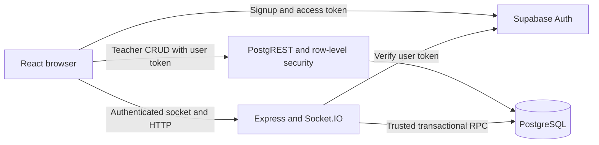
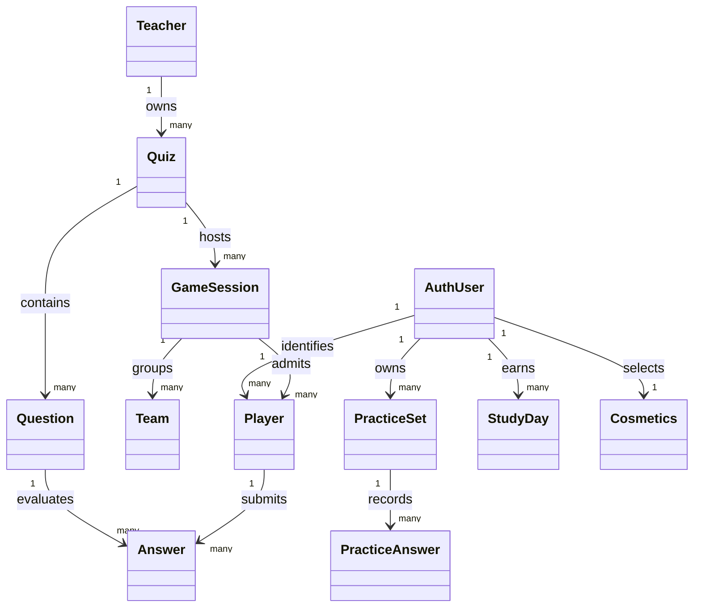
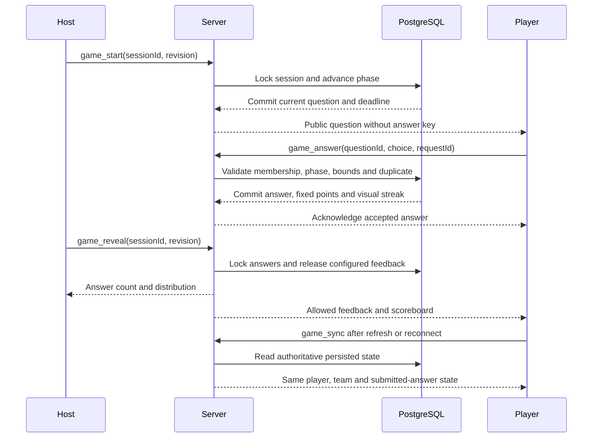

# Grasp: implementation and release report

Branch: `feat/game-creation` | Review date: November 8, 2026

## Scope and outcome

The supplied plan was implemented on the requested branch, extending the existing
authenticated lobby into a complete teacher-created quiz game. Repository changes
cover teacher accounts/enrollment, atomic quiz editing, hosting, server-controlled
play, scoring, recovery, results/CSV, study history, timers, feedback modes,
cosmetic rewards and competitive modes. AI drafting, tutoring and generated practice
were removed at the user's request. Deployment and verification are included.

This report records repository work and local evidence. It is not a claim that the
hosted application, email delivery, physical devices, collaborator
access, or the separate course report have been verified. The backlog marks GR-16
and GR-18 complete, but their external artifacts were not supplied for inspection.

## Architecture and trust boundaries

The browser receives only a publishable key. The server secret remains in the server
environment. New registrations are students unless a confirmed user explicitly
enrolls using an administrator invitation. Editable user metadata cannot authorize
teacher access. Existing teacher records remain enrolled during migration.

Quiz ownership is enforced by grants and RLS. `save_quiz` locks the quiz, checks its
revision, and replaces unhosted questions in one transaction. Hosted questions are
immutable; teachers duplicate them to edit or archive the quiz. The browser editor
validates four choices and warns about unsaved navigation.

Only the server can execute `game_command` and `game_data`.
The verified Auth user ID is supplied by the server. Raw player scores and answer
rows are unavailable to students through the Data API. Each socket receives an
audience-filtered state rather than a shared answer-bearing broadcast.

## Domain model

The database stores session phase, current question, revision, question start time,
optional deadline, game mode and feedback mode. Player membership and team assignment
survive disconnects. Socket.IO tracks only presence. All accepted answer data, points
and streak changes commit before the acknowledgement is sent. PracticeSet and
PracticeAnswer remain as legacy storage to preserve historical totals and rewards;
there are no generation or practice endpoints.

## Gameplay and recovery

Phases are lobby, question, feedback, and results. Start/Next/End use revision checks
to prevent accidental repeated transitions. Each player/question has one accepted
attempt; a retry never adds points again. Correctness awards fixed question points.
Speed, streaks, cosmetics and game modes never multiply scores. Missing answers have
zero attempts and points in exports. Wrong or missed questions reset visual streaks.

Instant mode releases only the submitting player's feedback while a question is
open. After-question mode waits for the lock. End-of-game mode withholds student
answer keys, outcomes and scoreboards until results. Teachers see their own keys
and response information. CSV exports are owner-filtered, quote multiline values,
and neutralize spreadsheet formula prefixes.

Timed answers are rejected after the database deadline, even during a server restart.
A scheduler closes timed-out questions; sync also repairs overdue state. Disconnects
do not delete players or answers. Host absence pauses untimed progress until the host
returns. Expired sessions finish after 24 hours. Single-instance hosting is required
until shared presence, rate budgets and a compatible socket adapter are added.

## Sprint delivery and next checks

| Milestone          | Repository implementation                                                                                                                       | Remaining release evidence                                                                           |
| ------------------ | ----------------------------------------------------------------------------------------------------------------------------------------------- | ---------------------------------------------------------------------------------------------------- |
| Sprint 1: GR-01-18 | Existing foundation preserved; teacher auth/enrollment, protected routes, quiz editor/dashboard, host lobby and browser smoke coverage added    | Real Auth confirmation/recovery, collaborator access and integration into the external course report |
| Sprint 2: GR-19-29 | Live questions, feedback/sound, host controls, fixed scoring, team totals, streaks, atomic answers, deployment files and sequence documentation | Staging deployment and actual multi-device/network smoke                                             |
| Sprint 3: GR-30-37 | Progress, results, own/class CSV, history, automatic resume, 40-player concurrent test, responsive UI and automated accessibility checks        | iOS Safari, Android Chrome and screen-reader/manual keyboard review                                  |
| Sprint 4: GR-38-42 | Timer toggle, feedback timing, optional student account linking/history and demo preparation; GR-39 AI drafting removed by request | Real email linking and final release rehearsal |
| P2: GR-43-46       | Persistent cosmetic inventory and duel/free-for-all modes; GR-43 tutor/adaptive difficulty and GR-46 generated practice removed by request | Rewards and competitive-mode classroom acceptance |

P2 ownership remains with the project maintainers; no named person's assignment is
invented. Suggested remaining acceptance effort is 1 hour for rewards and 2 hours
for competitive-mode classroom checks. These are new review estimates, not values
copied from the backlog.

## Verification evidence

The full check command passes 19 frontend tests, 17 server tests and 38 database
tests, plus lint, production build and migration-snapshot consistency. The original
database suite deliberately remains a regression check for the initial migration;
the new game suite applies the entire migration chain and verifies the hardened rules.

The concurrent integration test runs 40 Socket.IO clients against the real SQL
transactions in embedded PostgreSQL. It checks burst answers, correct totals,
unrelated-room denial, duplicate tabs, server restart, restored membership and
owner-filtered results/CSV. One observed 40-answer burst completed in 2.7 seconds
while other tests ran. This is local functional/load evidence, not hosted latency
or multi-connection PostgreSQL performance certification.

Browser checks exercise signup-to-invitation enrollment, teacher isolation, creating
a quiz, hosting three independent student contexts, submission lock, refresh,
feedback, results and download. Axe checks the teacher dashboard and mobile feedback
screen. The mobile viewport has no horizontal page overflow. Auth and Data API
transport are local fixtures; real Supabase mail and PostgREST remain release checks.

The server regression suite verifies that removed AI and practice URLs return 404
while authenticated study history and cosmetic selection remain available. Study
streak tests retain coverage of permanent rewards after a missed day. No AI provider
client or configuration remains in the application.

## Reproducible demonstration

1. Follow `docs/deployment.md`, apply migrations, and configure the browser/server.
2. Sign up a teacher, verify the email, sign in and enroll with a private invitation.
3. Create two questions with explanations. Keep timers off for the first run.
4. Host the quiz. Join three separate profiles/devices with different nicknames.
5. Start, submit one correct and one incorrect answer, then refresh a student.
6. Reveal, inspect team scores and explanation, then advance and finish.
7. Download a student's own CSV and the teacher's class CSV. Open session history.
8. Repeat with end-of-game feedback and an optional timer; interrupt the connection.
9. Link a guest to email, inspect study history and teacher-written explanations,
   and demonstrate earned cosmetics.

Use disposable demonstration data. Do not delete student accounts with learning
history during cleanup. The orphan-guest cleanup script is a dry run by default and
requires an explicit matching project reference to apply deletions.

## Release dependencies and sources

Docker is installed but its daemon was not running during this work. Local real
Supabase suites therefore remain unrun. No hosted migration, production deployment,
legacy-key revocation or team-access change was performed. The supplied
spreadsheet and external course artifacts were not modified.

Primary implementation references: Supabase Auth anonymous users and role security
(`https://supabase.com/docs/guides/auth/auth-anonymous`); Socket.IO delivery guarantees
(`https://socket.io/docs/v4/delivery-guarantees/`); Vercel Vite routing
(`https://vercel.com/docs/frameworks/frontend/vite`). Repository setup and event details
are in `docs/deployment.md` and `docs/game-contract.md`.
